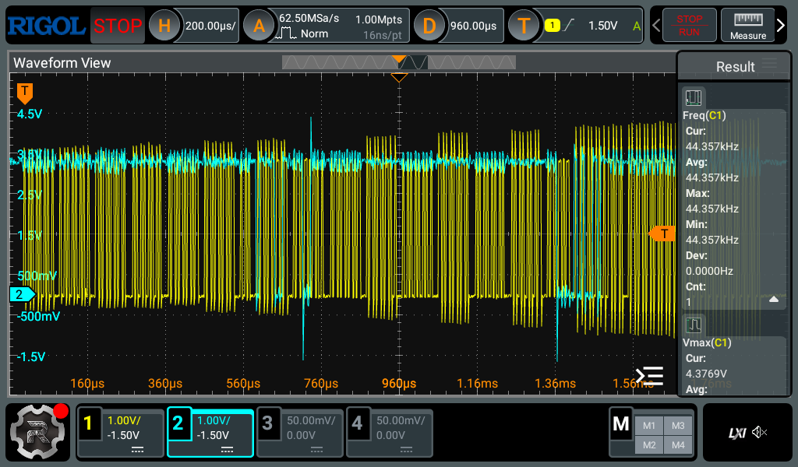

# Pico SWD probe bring-up

Recorded 2026-11-11 during bring-up of the v2 nRF5340 flight-controller board.
This note captures the investigation and the evidence, including what each
test did and did not prove.

## Starting point

The board was not initially responding over SWD. Several things could have
been wrong: probe firmware, wiring, connector contact, target power, debug
protection, or the firmware/tool configuration. Rather than treating a failed
flash as proof of a faulty MCU, the first test removed the target and checked
the probe's outputs directly.

## Probe firmware and wiring

The probe is a Raspberry Pi Pico H running Raspberry Pi's CMSIS-DAP debugprobe
firmware. The Pico initially had `debugprobe.uf2`, the build for the dedicated
Debug Probe accessory. Replacing it with `debugprobe_on_pico.uf2`, the build
for a Pico, corrected the GPIO mapping. The distinction is documented in the
[debugprobe project](https://github.com/raspberrypi/debugprobe).

| Signal | Pico physical pin | Pico GPIO | Flight-controller J1 |
|---|---:|---|---:|
| Ground | 3 | GND | 3 or 5 |
| SWCLK | 4 | GP2 | 4 |
| SWDIO | 5 | GP3 | 2 |

These are physical pin numbers, not GPIO numbers. In particular, Pico pin 5
connects to **J1 pin 2**, not J1 pin 5. J1 pin 1 is target 3.3 V / VTref;
the board was powered separately. The board nets can be checked in the
[PCB layout](v2/drone_fc.kicad_pcb).

With the target disconnected, CH1 was connected to SWCLK, CH2 to SWDIO, and
the scope grounds to Pico ground. The [SWD test tool](../../crates/swd-test/src/main.rs)
initiated a 100 kHz `probe-rs info` transaction and decoded the captured
signals. No target response was expected in this isolated test.

## Preserved scope trace

On 2026-11-11 the existing stopped acquisition was read from the Rigol DHO804
without triggering another acquisition. The trace is consistent with the
earlier isolated probe test, but its original acquisition time and exact
wiring were not independently recorded at retrieval.



- [Scope screenshot](captures/swd-probe-2026-11-11/scope.png)
- [CH1 raw samples](captures/swd-probe-2026-11-11/ch1.bin) and
  [CH2 raw samples](captures/swd-probe-2026-11-11/ch2.bin)
- [Capture metadata and waveform preambles](captures/swd-probe-2026-11-11/metadata.json)

Each raw file contains 1,000,000 unsigned 8-bit sample codes, not voltages.
The acquisition interval is 16 ns (62.5 MS/s). For sample index `i`,
the waveform preamble gives:

```text
time_seconds = -0.008 + i * 0.000000016
volts = (code - (-43) - 128) * 0.034133
```

The metadata records the preamble separately for each channel, the displayed
settings, probe attenuation, and trigger state. The scope was stopped before
and after reading. The 10x attenuation settings must match the physical probe
switches for the voltage readings to be meaningful.

Analysis of the saved samples using the test tool's thresholds found:

| Measurement | Result |
|---|---|
| CH1 low / high, 1st / 99th percentile | -0.102 V / 3.277 V |
| CH2 low / high, 1st / 99th percentile in clock-active window | -0.102 V / 3.311 V |
| SWCLK median rising-edge period | 10.016 us, approximately 99.84 kHz |
| Detected CH1 edges | 229 rising, 228 falling |
| Decoded initial sequence | 51 high clocks, `0xE79E` JTAG-to-SWD selection, 51 high reset clocks, 3 low idle clocks, `0xA5` DPIDR-read request |

Bits were sampled at detected SWCLK rising edges; the `0xA5` request has valid
start, stop, park and even-parity bits. The scope display's frequency
measurement is not the same calculation as the median clock period over the
captured burst.

The percentiles describe the logic levels, not the quality of individual
edges. The trace includes excursions beyond those levels; this capture alone
does not establish their cause or certify overshoot and ringing. The decode
shows a plausible outgoing sequence, not that the MCU acknowledged it.

## From probe activity to running firmware

1. With the wiring corrected and the TC2050 held against J1, probe-rs detected
   the Nordic debug port and application Cortex-M33. Contact was intermittent;
   a connection failure was not, by itself, evidence of a damaged MCU.
2. The original app build configuration targeted the nRF52833. It was changed
   to the nRF5340 secure application core and Cortex-M33 target.
3. probe-rs 0.30.0 encountered an nRF53 recovery regression. Version 0.32.0
   fixed that path and added the explicit application-only target:
   [recovery fix](https://github.com/probe-rs/probe-rs/pull/3701),
   [application-only target](https://github.com/probe-rs/probe-rs/pull/4111).
4. With erase permission, application-core recovery and a verified flash
   succeeded, but the first Embassy image did not light the LED. A later
   debug attempt showed a HardFault and P0.28 still configured as an input;
   the cause was not established.
5. A minimal register-level image lit the status LED on P0.28, including after
   a cold boot. This demonstrated flash retention, startup, and the LED path.
   The Embassy application was then restored and made to blink the LED.
6. The app assigned P0.31 to the network core and released it. A separate
   network image blinked the radio LED; both LEDs were observed blinking at
   different rates after a cold boot. Each image was subsequently flashed
   separately and the other image verified unchanged.

An unavailable network-core debug port led probe-rs to report the core as
locked. Allowing recovery can erase firmware; during this investigation it
reported both cores locked and both images had to be restored. Do not equate
that message alone with proof of a permanent hardware fault or blindly grant
an erase. The [electrical README](README.md) records the current, verified
separate-flashing procedure and its limitations.

## Takeaways for a talk

- Start with a smaller observable question: is the probe generating the right
  electrical signals before introducing the target?
- GPIO numbering, connector pin numbering, and firmware build variants are
  separate layers; each needs checking.
- A decoded request proves more than an LED or a generic activity trace, but
  still does not prove a target response.
- A verified flash, a running LED, and a cold boot test different parts of the
  path. Two differently paced LEDs also demonstrate both cores running.
